# Bash Script Automation Drill Submission

**Full Name:** Jamiu Dahunsi
**Group:** Group 1
**Date:** 10-10-2026

---

## Task 1 - Bash Environment & Workspace Setup
**Screenshot 1:** Output of echo $SHELL and ash --version
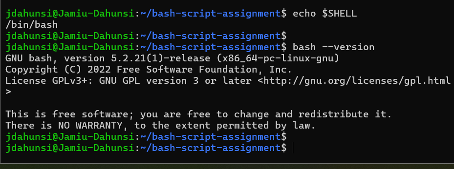

**Screenshot 2:** Output of pwd and ls -lah
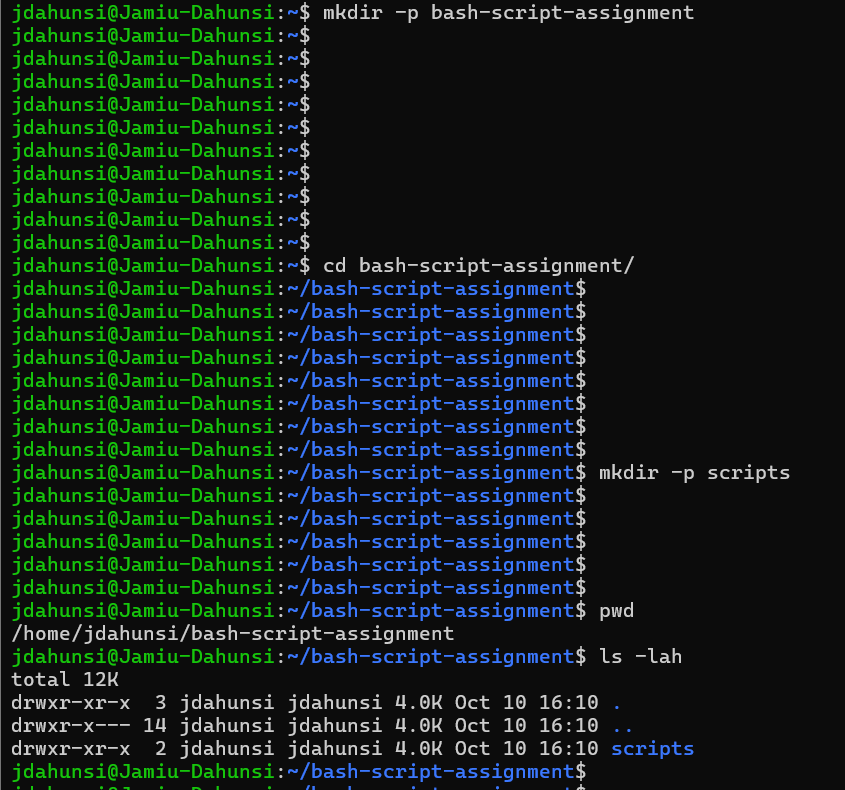

**Notes You Must Write:**
*   **What is Bash?** Bash (Bourne Again SHell) is the default command-line interpreter and scripting language for most Linux distributions.
*   **What is the difference between shell and Bash?** "Shell" is the general concept of a program that takes keyboard commands and passes them to the operating system. "Bash" is a specific, highly popular implementation of a shell.
*   **Why is it important to confirm the Bash version before writing scripts?** Different versions of Bash support different features. Confirming the version ensures your script will run without compatibility errors.

---

## Task 2 - Your First Bash Script
**Screenshot 1:** Content of first-script.sh
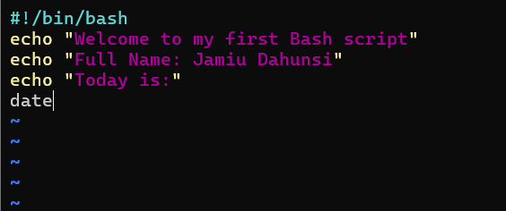

**Screenshots 2 & 3:** Script Execution and Permissions
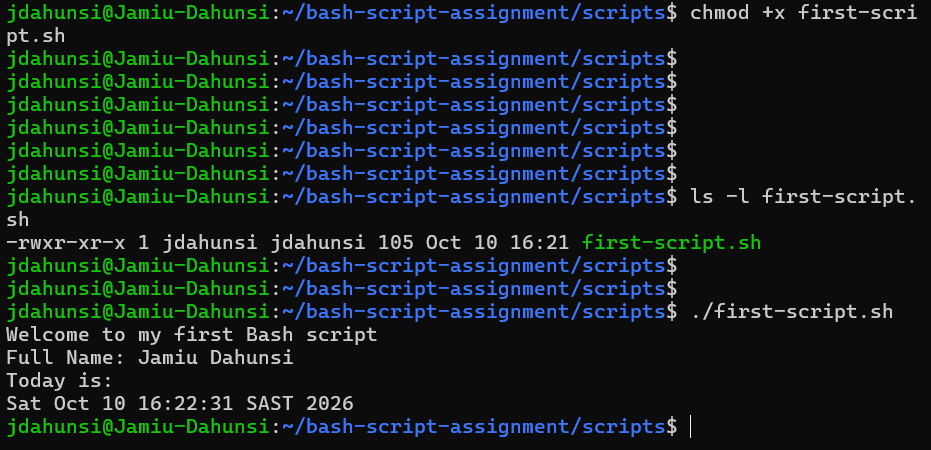

**Notes You Must Write:**
*   **What is the purpose of #!/bin/bash?** This is the shebang. It tells the Linux operating system exactly which interpreter to use to read and execute the script.
*   **Why do we use chmod +x before running a script?** By default, Linux protects the system by making newly created text files non-executable. chmod +x explicitly grants the security permission required to run it as a program.
*   **What is the difference between running a script using ./script.sh and ash script.sh?** Using ./script.sh relies on the file's execute permissions and the shebang line to determine how to run it. Using ash script.sh forces the Bash program to read the file, bypassing the execute permission requirement.

---

## Task 3 - Variables: User Information Script
**Screenshot:** Output of ./user-info.sh
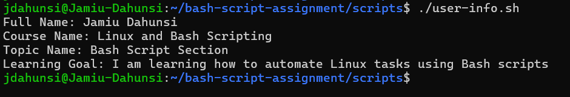

**Notes You Must Write:**
*   **What is a variable in Bash?** A variable is a named container in memory used to store data that can be referenced or changed later in the script.
*   **Why should we avoid spaces around the = sign when creating variables?** In Bash, spaces dictate command structure. If you add spaces around the equals sign, Bash interprets the variable name as a command and the value as an argument, causing a syntax error.
*   **How do you access the value stored inside a Bash variable?** You prepend the variable name with a dollar sign (e.g., $full_name).

---

## Task 4 - Arrays & Loops: Tools Checklist Script
**Screenshot:** Output of ./tools-checklist.sh
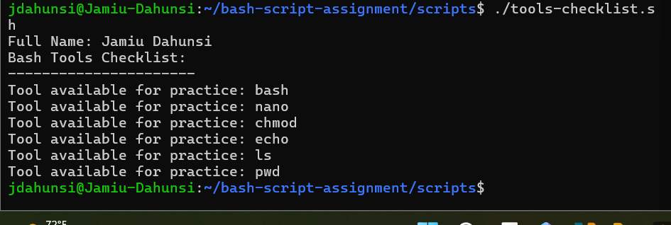

**Notes You Must Write:**
*   **What is an array in Bash?** An array is a special type of variable that can store a list of multiple values under a single name.
*   **Why are arrays useful in scripts?** They allow you to group related data (like a list of servers or tools) and process them systematically using loops, reducing code duplication.
*   **What does "${tools[@]}" mean?** The @ symbol expands the array to include every individual element inside it, allowing a loop to process all items.
*   **What is the purpose of the for loop in this script?** The for loop iterates through the array, running the echo command once for every single tool listed in the array.

---

## Task 5 - Loops: Number Counter Script
**Screenshot:** Output of ./counter.sh
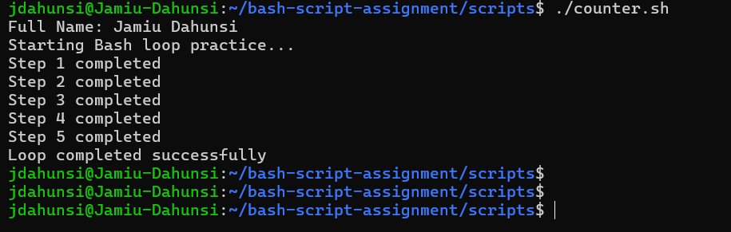

**Notes You Must Write:**
*   **What is a loop?** A loop is a programming construct that repeats a specific block of code multiple times.
*   **Why do we use loops in Bash scripting?** Loops automate repetitive tasks, saving time and preventing human error when performing the same action across many items.
*   **How many times did the loop run in your script?** 5 times.
*   **What would you change if you wanted the loop to run 10 times?** I would change the sequence 1 2 3 4 5 to 1 2 3 4 5 6 7 8 9 10.

---

## Task 6 - Files & Conditionals: File Validation Script
**Screenshot 1:** Output of ls -lah ../test-folder
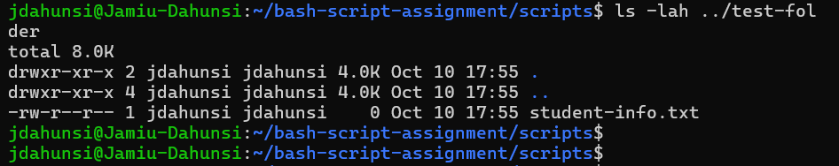

**Screenshot 2:** Content of file-check.sh
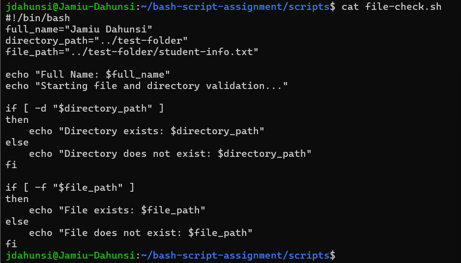

**Screenshot 3:** Output of ./file-check.sh
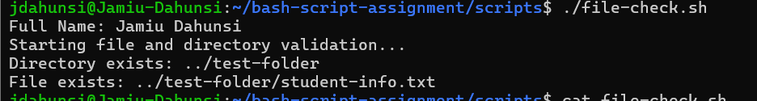

**Notes You Must Write:**
*   **What does -d check in Bash?** It checks if the provided path exists and is a directory.
*   **What does -f check in Bash?** It checks if the provided path exists and is a regular file.
*   **Why should file and directory paths be stored in variables?** It makes the script easier to maintain. If the path changes, you only have to update the variable once at the top of the script rather than modifying every single line that references it.
*   **What happens if the file does not exist?** The conditional test returns false, causing the script to skip the if block and execute the code inside the else block instead.

---

## Task 7 - Conditionals: Pass or Retry Script
**Screenshots 1 & 2:** Result Pass
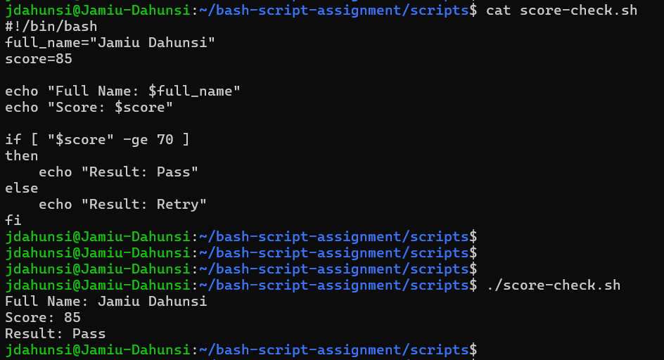

**Screenshots 3 & 4:** Result Retry
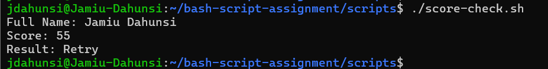

**Notes You Must Write:**
*   **What is the purpose of if-else in Bash?** It allows the script to make logical decisions and run different blocks of code based on whether a condition is true or false.
*   **What does -ge mean?** It is a numerical comparison operator meaning "greater than or equal to".
*   **Why should conditions be tested with different values?** Testing both true and false values ensures that both the if block and the else block function correctly without hidden syntax errors.
*   **How can conditionals help in automation scripts?** They allow scripts to handle unexpected scenarios dynamically (e.g., if a server is offline, trigger an alert) without requiring human intervention.

---

## Task 8 - Functions: Final Bash Automation Script
**Screenshot 1:** Content of final-automation.sh
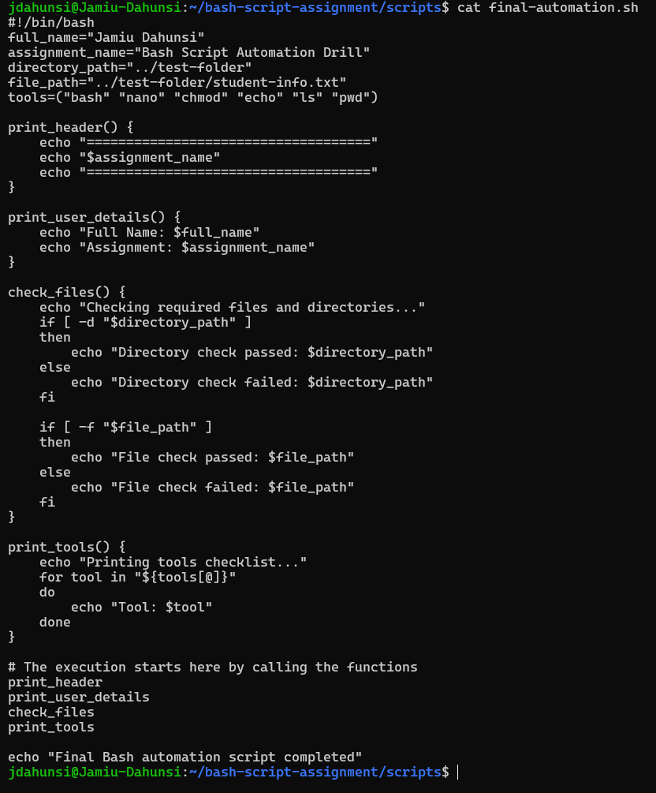

**Screenshots 2 & 3:** Output and Directory Verification
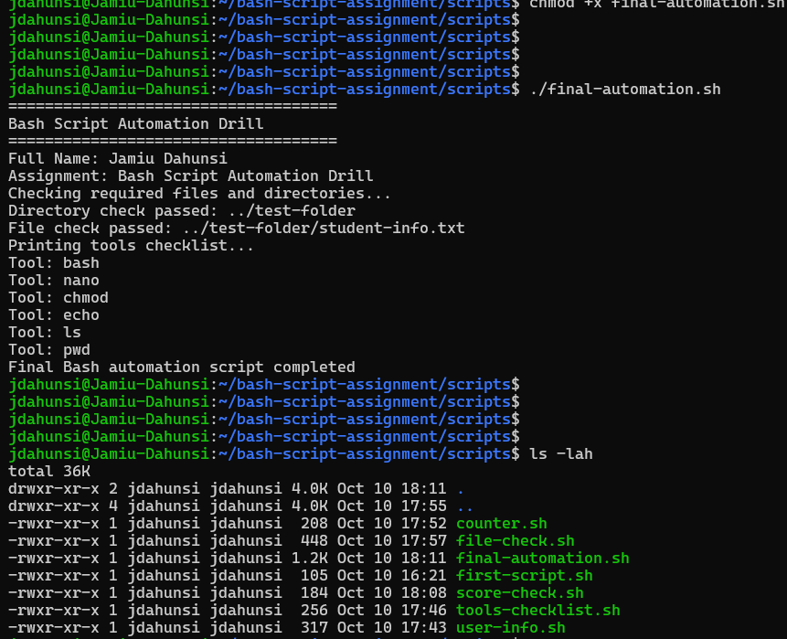

**Notes You Must Write:**
*   **What is a function in Bash?** A function is a named, reusable block of code that executes a specific task.
*   **Why are functions useful in scripts?** They eliminate duplicate code, make scripts much easier to read, and allow you to quickly execute complex instruction sets with a single command.
*   **Which functions did you create in this script?** print_header, print_user_details, check_files, and print_tools.
*   **How does this final script combine variables, arrays, loops, conditionals, files, and functions?** Variables store static data, arrays store lists, loops iterate through those lists, conditionals verify system state, and functions organize all these actions into clean, modular blocks that are called at the end of the script.
